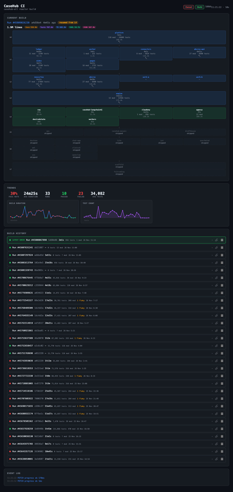
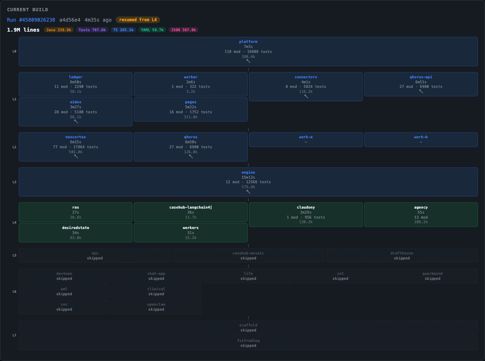
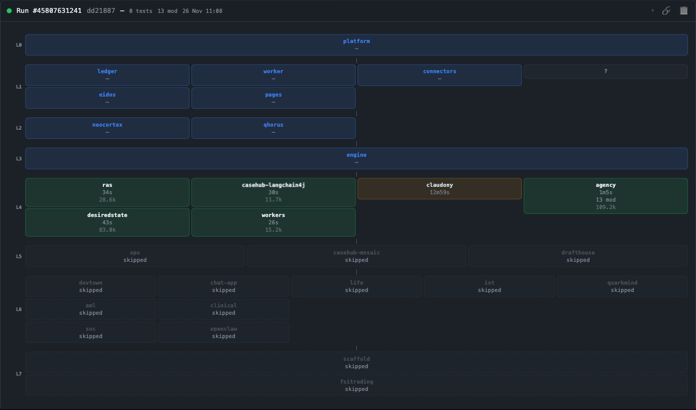

# CaseHub CI — Cross-Repo Build & Dashboard

**Live dashboard:** https://casehub.org/casehub-all/

CaseHub is a multi-repo ecosystem (~30 repos) under the `casehubio` GitHub org.
`casehub-all` verifies the entire ecosystem compiles and passes tests together,
using git submodules to pull all repos into a dependency-optimized parallel
pipeline. The committed submodule SHAs represent the last verified-green
combination of all repos.

## Quick Start — Building Locally

The parent repo includes `build-all.sh` which clones all repos at their
last verified-green SHAs and builds them in a single Maven reactor:

```bash
git clone https://github.com/casehubio/parent.git
cd parent
./build-all.sh              # verified SHAs, aggregate reactor, skip tests
./build-all.sh --help       # prerequisite check + all options
```

By default, `build-all.sh` fetches the submodule SHAs from `casehub-all` main
— the last combination that passed all tests. This is the safest onboarding
path.

| Flag | Effect |
|------|--------|
| `--head` | Use latest HEAD of each repo instead of verified SHAs |
| `--revision=<sha>` | Use SHAs from a specific casehub-all commit (reproducible builds) |
| `--incremental` | Per-repo change detection — only rebuild changed repos |
| `--skip-tests` | Skip test execution (`-DskipTests`) |
| `--no-cache` | Force full rebuild, ignore incremental cache |
| `--local` | Build from current checkout (no git fetch/reset) |
| `--help` | Show usage and check prerequisites (java, mvn, git, node, yarn) |

The `--revision` flag is key for reproducibility. Every CI build records a
casehub-all commit SHA containing all submodule SHAs. You can reproduce any
build locally by passing that SHA.

## Why casehub-all Exists

Per-repo CI only proves that each repo compiles and passes tests against the
SNAPSHOT artifacts that happened to be in GitHub Packages at that moment. It
cannot detect cross-repo breakage:

- **API drift:** Repo A changes a method signature and publishes. Repo B's CI
  runs before B's code is updated — it pulls A's new SNAPSHOT and fails. But
  if B's CI ran a minute earlier, it would have pulled A's old SNAPSHOT and
  passed. Per-repo CI gives inconsistent results depending on timing.
- **Diamond dependencies:** Repo C depends on both A and B. A and B both
  depend on platform. If platform publishes a breaking change and A updates
  but B hasn't yet, C's CI might pull updated-A and stale-B — a combination
  that was never tested together.
- **No reproducibility:** Per-repo CI builds against whatever SNAPSHOTs
  are currently published. There's no record of which exact combination of
  repo versions was verified.

casehub-all solves these problems:

- **Source-level, staged pipeline:** All repos build from source in dependency
  order. Each level runs `mvn install`, populating `.m2` for subsequent levels.
  API drift is caught immediately.
- **Reproducible SHA manifest:** Every build records the exact SHA of every
  repo. `git submodule status` is the bill of materials.
- **Pointer advance = verified state:** The committed submodule pointers
  represent the last combination that compiled together. Anyone cloning
  casehub-all gets a known-good set of versions.

## Pipeline Architecture

### 8-Level Parallel Pipeline

The pipeline topology is defined in **`docs/pipeline.yaml`** — a single
source of truth. The workflow, dashboard, resume options, and matrix
generation all derive from this file. To change topology: edit pipeline.yaml;
everything else updates automatically.

```
L0:  platform                                              (1 job)
       │
L1:  [ledger+eidos] | connectors | [worker+pages] | qhorus-api  (4 parallel)
       │
L2:  neocortex | qhorus | work (compile)                  (3 parallel)
       │
L3:  engine (compile) | work-tests-a | work-tests-b       (3 parallel)
       │
L4:  [ras+ds] | claudony | agency | [lc4j+workers]        (4+3 parallel)
       + engine-tests-a | engine-tests-b | engine-tests-c
       │
L5:  ops | casehub-mosaic | drafthouse                     (3 parallel)
       │
L6:  life | iot | quarkmind | [devtown+aml+soc] | [chat-app+clinical+openclaw]  (5 parallel)
       │
L7:  [scaffold+fsitrading]                                 (1 job)
       │
fin: dashboard finish + pointer advance
```

Each level waits only for its immediate dependency level. Repos within a level
run in parallel via `strategy.matrix`. Bundled repos (e.g., `[ledger+eidos]`)
build sequentially within a single runner.

### Data-Driven Workflow

The workflow is data-driven from `docs/pipeline.yaml`:

1. **Config job** (always runs, even on resume): reads pipeline.yaml, computes
   runtime matrices and timeouts as JSON blobs, initializes the dashboard.
2. **Each level job**: ~15 lines — checkout + composite action call. The
   composite action (`.github/actions/build-level/action.yml`) handles all
   shared steps: submodule init, Java/Node setup, Maven cache, snapshot cache,
   artifact download/upload, build, and dashboard reporting.
3. **Finalize job**: merges dashboard phase data, advances submodule pointers
   on success, saves snapshot cache, auto-retries on transient failure.

This eliminated code duplication — the workflow went from 1,698 lines (with
per-level copy-paste) to 628 lines.

### Ad-hoc Slicing Across Levels

A single repo can appear at multiple levels with different build scopes.
In pipeline.yaml, this is expressed with `names` overrides and `maven_extra`:

```yaml
- id: L1
  names:
    qhorus: qhorus-api        # display name on dashboard
  maven_extra:
    qhorus: "-pl api -am"     # only build the API module
  stacks:
    - [qhorus]

- id: L2
  stacks:
    - [qhorus]                # full build (all modules)
```

Qhorus API is needed by work (L2), but the full qhorus build also needs
work's output. By splitting qhorus-api to L1, work and qhorus can build
in parallel at L2.

Object stack entries support A/B splits for large repos:

```yaml
- repos: [work]
  name: work-a
  maven_extra: "-pl api,core,client,... -am"
- repos: [work]
  name: work-b
  maven_extra: "-pl progress-api,progress-core,... -am"
```

### Test Slicing — Compile Once, Fan Out Tests

Large repos (engine: 77 min, work: 25 min) can split their test execution
across multiple parallel runners. The repo compiles once at its level
(with `-DskipTests`), then test-only slices run at the next level.

```yaml
# Auto-distribute engine's test modules into 3 balanced slices
- repos: [engine]
  test_slices: 3

# Auto-distribute with pinning — isolate a heavy module
- repos: [engine]
  test_slices:
    count: 3
    pin:
      - slice: 0
        modules: [spring-integration-test]

# Manual module lists (backward compat)
- repos: [work]
  test_slices:
    - name: work-tests-a
      modules: "api,core,client,runtime"
    - name: work-tests-b
      modules: "progress-api,progress-core,ledger"
```

**Auto-distribution** discovers modules from the repo's `pom.xml`, filters
to modules with `src/test/`, estimates test time (QuarkusTest → 3 min,
unit tests → 1 min), and bin-packs into balanced slices using greedy
largest-first. Slice names follow the `{repo}-tests-{a,b,c}` pattern.

Test slicing is only active when `test_mode=run`. With `test_mode=skip`
(the default), test_slices are ignored and the repo builds normally.

### Artifact Passing

Each level uploads its built artifacts (new files only). The next level
downloads all prior artifacts and overlays them on the snapshot cache. The
upload uses a **diff strategy** — before each build, the existing `.m2`
contents are recorded; after the build, only files that didn't exist before
are uploaded. This prevents the merge-multiple corruption that occurs when
multiple jobs upload overlapping archive contents.

### Resume and Auto-Retry

The `resume_from` input skips earlier levels, resuming from cached artifacts.
On resume, the config job **auto-detects** which repos failed in the previous
run and only rebuilds those repos at the resume level.

```bash
# Resume from L4 — auto-detects failed repos
gh workflow run mvn-all.yml --repo casehubio/casehub-all -f resume_from=L4

# Resume from L4 — only rebuild connectors
gh workflow run mvn-all.yml --repo casehubio/casehub-all -f resume_from=L4 -f resume_repos=connectors
```

If a build fails, the finalize job auto-retries by dispatching a new run
with `resume_from` set to the failed level (max 2 retries).

## CI Dashboard

A live build progress dashboard at **https://casehub.org/casehub-all/**
(GitHub Pages from `docs/`). Build data is stored in a Cloudflare Worker + KV
store.



### What You See

**Current build** shows the pipeline with real-time status per repo. Each
phase box shows: status colour, duration, module count, test count, and
lines of code.

**On a resumed build**, levels before the resume point show in **blue**
with their data carried forward from the previous green build. This
immediately tells you: "these levels passed before — the current run is
only rebuilding from L4 onwards." Levels after the resume point that
haven't started yet show as grey "skipped".



### Build History

Each build in history shows:

- **Status dot** (green/red) and **Run #** — click the run number to open
  the GitHub Actions run page.
- **Commit SHA** — the casehub-all commit. This is the bill of materials:
  it contains all submodule SHAs, so it uniquely identifies the exact
  combination of repo versions that were built.
- **Duration**, **test count**, **module count**, **flaky count**.


The **LATEST GREEN** tag pins the most recent successful build at the top of
history with a green border. This is the verified-green combination — the
same SHAs that `build-all.sh` uses by default when you run it without
`--head`.

### Copy Buttons

Each history row has two buttons:

- **🔗 (link)** — copies a permalink URL for that build
  (e.g., `https://casehub.org/casehub-all/#run=45788676445`). Share it to
  point someone at a specific build.
- **📋 (build-all)** — copies a `build-all.sh --revision=<sha>` command
  that reproduces that exact build locally. The SHA is the casehub-all
  commit, which pins all 30+ repos to the exact versions that were tested.

### Pinned URLs

Append `#run=<id>` to the dashboard URL to open a specific build directly.
When you copy a link with the 🔗 button, this is the URL format used. Opening
the URL auto-expands that build's history entry.

### Expanded Build View

Click any history row to expand the full pipeline visualization for that
build, showing per-repo stats, test failures, self-healing events, and
slowest modules/tests.



### Dashboard Architecture

| Component | Location |
|-----------|----------|
| Pipeline topology | `docs/pipeline.yaml` (single source of truth) |
| Dashboard HTML | `docs/index.html` (HTML+CSS+JS, loads js-yaml CDN) |
| Data store | Cloudflare Worker + KV at `casehub-ci-dashboard.casehub.workers.dev` |
| Worker source | `docs/worker/src/index.js` |
| Dashboard init | `docs/init-dashboard-full.py` (creates phases from pipeline.yaml, carries forward cached data on resume) |
| Update script | `docs/update-progress.sh` (phase-file, phase, finish commands) |
| Maven wrapper | `docs/run-with-progress.sh` (dashboard updates, self-healing, timing) |

The init runs in the config job (not prepare), so dashboard data is available
immediately — even on resume builds where prepare is skipped.

## SHA Management and Submodule Pointers

casehub-all tracks every repo as a git submodule. Each submodule pointer is a
SHA — the exact commit that was last verified to compile with the rest of the
ecosystem.

### The Build Cycle

```
1. Gate: check for in-progress runs (abort or cancel based on input)
2. Config: compute matrices from pipeline.yaml, initialize dashboard
3. Warm cache (full builds only): download third-party deps, cache for reuse
4. Prepare (full builds only): checkout, submodule init, platform base build
5. L1–L7: build ecosystem in dependency order, parallel within each level
6. Finalize: merge dashboard data, advance pointers if green, save cache
7. If failed: auto-retry with resume_from at the failed level (max 2 retries)
```

**Pointer advance is all-or-nothing.** A failure in any level prevents
advancing any pointers. The committed SHAs on main always represent a
fully-verified combination.

### Resuming from a Level

The `resume_from` input skips earlier levels and uses the snapshot cache
(casehub SNAPSHOT artifacts from the last successful build). Valid resume
points: L1, L2, L3, L4, L5, L6.

**When resumption is safe:** Immediately after a failure, when the fix is in
the failing repo or later. Example: test failure in agency (L4) — fix and
push agency, then `resume_from=L4`.

**When resumption is unsafe:** When the fix is in an upstream repo (platform,
engine, etc.) that earlier levels depend on. Resume levels download upstream
artifacts from cache, not from source. Use a full rebuild instead.

### Submodule Update Modes

| Mode | Behavior |
|------|----------|
| `pinned` (default) | Use committed SHAs — deterministic, reproducible |
| `all` | Pull latest main for every repo |
| `list` | Pull latest main only for named repos |

## Parent BOM and Version Management

All repos extend `casehub-parent` — a single Bill of Materials (BOM) POM that
centralises dependency versions, plugin configuration, and enforcer rules.

### What casehub-parent manages

- **Quarkus BOM** (3.39.x) — all Quarkus dependencies
- **Spring Boot BOM** (4.1.x) — all Spring dependencies
- **Serverless Workflow** (7.35.3.Final) — workflow type system
- **LangChain4j** (1.19.x) — LLM integration
- **Surefire** (3.5.5) — test runner, with `forkedProcessTimeoutInSeconds=300`
- **Maven Enforcer** — `dependencyConvergence` rule

## Dependency Graph

Every cross-repo dependency is declared in `parent/build/modules-core.csv` and
`modules-applications.csv`. These determine build order and are validated by
`docs/check-cycles.py` at the start of every build.

### Level Assignment Rationale

| Level | Repos | Why this level |
|-------|-------|---------------|
| L0 | platform | Foundation for everything |
| L1 | ledger, eidos, connectors, worker, pages, qhorus-api | Depend only on platform |
| L2 | neocortex, qhorus (full), work (compile) | Need eidos/connectors (L1), qhorus-api (L1) |
| L3 | engine (compile), work test slices | Needs work (L2), neocortex (L2), qhorus (L2) |
| L4 | ras, desiredstate, claudony, agency, langchain4j, workers + engine test slices | Need engine (L3) |
| L5 | ops, casehub-mosaic, drafthouse | Need agency (L4), desiredstate (L4) |
| L6 | life, iot, quarkmind, devtown, aml, soc, chat-app, clinical, openclaw | Apps — need L5 modules |
| L7 | scaffold, fsitrading | Need ops (L5) |

### Bundling Strategy

Repos are bundled into single jobs to avoid runner overhead (~1-2 min per job
for checkout + cache restore + artifact download). The sweet spot is ~5-15
minutes per bundle — fast enough not to bottleneck, but long enough to
amortize setup.

## Workflow Inputs

| Input | Type | Default | Effect |
|-------|------|---------|--------|
| `test_mode` | choice | `skip` | `dry` = POM validate only (~4 min); `skip` = compile, no tests; `run` = compile + test |
| `resume_from` | choice | (empty) | Resume from: L1–L6. Skips earlier levels, uses cached artifacts. |
| `resume_repos` | string | (empty) | Only rebuild these repos at the resume level (comma-separated). Empty = auto-detect from previous run. |
| `submodule_update` | choice | `pinned` | `pinned` = committed SHAs; `all` = latest main; `list` = named repos only |
| `if_running` | choice | `abort` | `abort` = cancel this run if another is active; `cancel_existing` = cancel the other run |

```bash
# Compile-only, pinned SHAs (default)
gh workflow run mvn-all.yml --repo casehubio/casehub-all

# Full test run
gh workflow run mvn-all.yml --repo casehubio/casehub-all -f test_mode=run

# Resume from L4 (auto-detects failed repos)
gh workflow run mvn-all.yml --repo casehubio/casehub-all -f test_mode=run -f resume_from=L4
```

## Self-Healing Build

Every Maven build is wrapped in `docs/run-with-progress.sh` which classifies
failures:

- **Code failures** (compilation errors, test failures) — fail immediately
- **Infrastructure failures** (corrupt JARs, CDN errors, network, OOM) —
  diagnose, repair, retry

The self-healing registry handles corrupt JARs (re-download), corrupt Jandex
indexes (delete + rebuild), CDN resolution failures (clear `.lastUpdated`
markers), and OOM (retry with reduced parallelism).

## Operations

### Fixing a Red Repo

1. Reproduce locally: `mvn verify -f ~/casehub/REPO/pom.xml`
2. Fix, commit, push.
3. Advance submodule in casehub-all:
   ```bash
   git -C casehub-all submodule update --remote REPO
   git -C casehub-all add REPO && git -C casehub-all commit -m "chore: advance REPO" && git -C casehub-all push
   ```
4. Trigger CI: `gh workflow run mvn-all.yml --repo casehubio/casehub-all -f test_mode=run`

### Adding a New Repo

1. Add to `parent/build/modules-core.csv` or `modules-applications.csv`
2. Add as submodule in casehub-all
3. Add to the appropriate level and stack in `docs/pipeline.yaml`
4. Test with `test_mode=dry` to verify pipeline structure (~4 min)

## File Map

```
casehub-all/
  .github/
    workflows/mvn-all.yml              — 8-level parallel pipeline (data-driven from pipeline.yaml)
    actions/build-level/action.yml     — composite action (shared build steps for all levels)
  docs/
    pipeline.yaml                      — pipeline topology (single source of truth)
    index.html                         — CI dashboard (HTML+CSS+JS)
    screenshots/                       — dashboard screenshots for README
    compute-matrices.py                — reads pipeline.yaml, outputs runtime matrices + timeouts (auto test slicing)
    generate-slices.py                 — auto-assigns repo modules to compile-time aggregator POMs
    compute-mvn-flags.sh               — computes MVN_COMMON flags from workflow inputs
    init-dashboard-full.py             — dashboard init (phases from pipeline.yaml, carry-forward on resume)
    update-progress.sh                 — Cloudflare Worker updater (phase-file, phase, finish)
    run-with-progress.sh               — Maven wrapper with self-healing + dashboard reporting
    check-cycles.py                    — dependency graph cycle detection
    check-pipeline-consistency.py      — validates CSVs vs pipeline.yaml vs submodules
    auto-retry.sh                      — dispatches retry with resume_from on failure
    update-submodules.sh               — submodule update per mode (pinned/all/list)
    worker/
      src/index.js                     — Cloudflare Worker (KV store with run_id ownership)
      wrangler.toml                    — Worker configuration

parent/
  pom.xml                              — casehub-parent BOM
  build-all.sh                         — local build script (clone + aggregate reactor)
  aggregator.xml                       — single Maven reactor POM for all repos
  build/
    modules-core.csv                   — core repo dependency declarations
    modules-applications.csv           — app repo dependency declarations
    sync-deps.py                       — regenerate CSVs from actual POM dependencies
```

## Known Limitations

### resume_from relies on cached artifacts
Only safe when earlier levels haven't changed since the cached run. Always
run a full build (no `resume_from`) for definitive verification.

### Stale submodule pointers
The committed SHAs only advance when a full green build completes. If the
reactor is red, pointers stay at the last green build. This is by design
(pointers = verified state).

### Reactor-only CDI issues
Some modules have CDI deployment problems that only manifest in the
casehub-all reactor, not in standalone CI. The reactor classpath can differ
because Maven reactor resolution resolves from `target/` instead of `.m2`.
